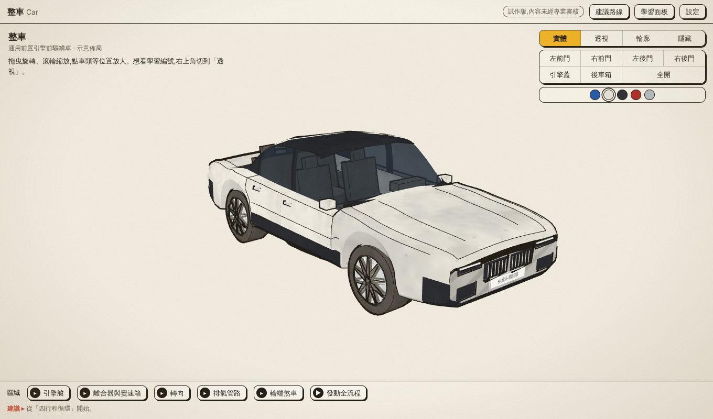

# 汽車怎麼運作(試作版)

> **試作版,內容未經專業審核。** 這是一個給汽修學習者自學用的互動 3D 教學網頁,可以旋轉整台車、點選區域放大,依序了解引擎、冷卻、充電與起動、離合器與變速箱、轉向、煞車與排氣。

## 怎麼用
- 打開網頁:拖曳旋轉、滾輪縮放,點車頭等位置進入「引擎艙」等區域,或用「發動全流程」看整條動力路線。
- 右上角可切換車殼顯示(實體 / 透視 / 輪廓 / 隱藏)、開關車門與引擎蓋、顯示學習編號。
- 每個主題有步驟、滑桿與「上一步 / 下一步 / 整個跑一遍」;學習進度存在**你自己的瀏覽器**裡(可在「建議路線」匯出 / 匯入)。
- 建議用電腦或筆電的 Chrome / Edge / Firefox / Safari;平板可以開,但較吃力。

## 內容品質
- 內容與數值多為**示意**,不是特定車款的規格;機構是通用前置橫置四缸前驅手排車。
- 說法逐條對照過 Wikipedia 並標示狀態(已核對 / 部分核對 / 未核對 / 示意值),報告在 [`docs/`](docs/)。Wikipedia 是通用參考,不是原廠手冊;**要用於正式教學或考試,請再對照課本或原廠維修資料。**
- 車殼是手繪風的運動房車造型,**沒有廠徽**,不是任何真實車款的複製品。

## 檔案
| 檔案 | 說明 |
|---|---|
| `index.html` | 整個網頁(單一檔案,離線可用,不需要伺服器) |
| `docs/` | 內容核對報告與佈局規格 |
| `preview/` | 預覽截圖 |
| `LICENSES.md` | 第三方授權(three.js, MIT) |

## 發佈到 GitHub Pages
1. 在 GitHub 建立新倉庫(Pages 免費版需要**公開**倉庫)。
2. 把這個資料夾**裡面的所有檔案**(包含隱藏檔 `.nojekyll`)上傳到倉庫根目錄。
3. Settings → Pages → Build and deployment → Source 選 **Deploy from a branch**,Branch 選 `main`、資料夾選 `/ (root)` → Save。
4. 等 1–2 分鐘,網址是 `https://你的帳號.github.io/倉庫名稱/`。
